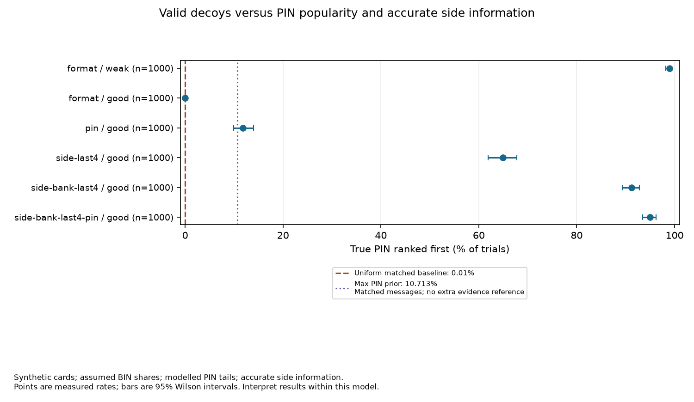

# Conclusion: believable decoys help, but distinguishing information defeats them

Our good distribution-transforming encoder (DTE) stops simple card-format checks
from identifying the real answer. It does not remove PIN popularity, accurate
personal information, or relationships between several records. Public RSA
verification and encryption-mode rejection checks provide other ways to discard
decoys. These are limitations of the assumptions behind honey encryption, not
breaks of AES or RSA.

## What we measured

The completed card study contains **56 configurations, 1,000 trials each**:
**56,000 simulated victims and 1.47 billion card decryptions**. Each trial generates
a synthetic card or wallet, encrypts it under a selected PIN, decrypts under all
10,000 possible PINs, ranks the candidates, and records the true PIN's position.
The same encryption PIN protects every card in a wallet; their actual bank-card
transaction PINs are not modelled.

**First-guess success** means the evaluator found the true PIN at position one
in the attacker's ordering. It does not mean the attacker always knows when a
guess is correct. Matching plaintexts under different PINs do not count as
recovering the original PIN. Every configuration's raw ranks, seeds and software
metadata are in [the recorded evidence](results/final-2026-10-20/README.md).

## 1. A good DTE removes the format attack's advantage

| DTE and attack | True PIN ranked first | Interpretation |
|---|---:|---|
| Weak DTE, format checks | 990/1,000 = **99.0%** | Most decoys fail card-format checks, exposing the real answer. |
| Good DTE, format checks | 0/1,000 observed | All candidates pass the format checks, leaving the attacker to break ties randomly. |
| Good DTE, PIN popularity | 118/1,000 = **11.8%** | Popular PINs remain useful even when every card looks valid. |
| Good DTE, format plus PIN popularity | 119/1,000 = **11.9%** | Format adds no discrimination; the small difference from PIN-only comes from a separate sampled run. |

All rows above use calibrated victim PIN frequencies. For a matched message
model, uniform PINs and no distinguishing evidence, the analytical first-guess
baseline is **1/10,000 = 0.01%**. The separate uniform baseline observed 1/1,000
successes (0.1%), while its format-only control observed zero. Neither replaces
the analytical baseline: 1,000 trials expect only 0.1 successes, and the chance
of at least one is about 9.5%. Zero observed successes do not prove zero risk.

The calibrated table assigns its most popular PIN probability **10.713%**.
The PIN-only 11.8% measurement is a sample estimate, not a new theoretical bound.
The weak-DTE PIN-only run observed 8.6% under a different seed: PIN-only scoring
does not use the decoded card, so this difference cannot be attributed to DTE
quality. Checks confirm these first-guess counts equal the sampled occurrences
of the most popular PIN.

## 2. Accurate personal information can defeat individually valid decoys

| Attacker's information, using the good DTE | First-guess success | 95% Wilson interval | Interpretation |
|---|---:|---:|---|
| Bank only | 0/1,000 observed | 0%–0.38% | Bank narrows the guess order, but many candidates still match. |
| Last four digits | **64.9%** | 61.89%–67.80% | The suffix removes much of the ambiguity between valid cards. |
| Bank and last four digits | **91.2%** | 89.28%–92.80% | Combining facts leaves fewer plausible candidates. |
| Bank, last four and PIN popularity | **95.0%** | 93.47%–96.19% | Combining accurate facts with likely PINs is especially effective. |

In the last row, the true PIN was within the first two guesses in **99.7%** of
trials and within the first three in **100%** of these trials. These results
assume the attacker knows the named facts correctly. Noisy or incorrect facts
could reject the true card and are outside this experiment. Bank-only still
reduced median rank to **792**, so first-guess success alone misses part of its
effect.

## 3. Correlated wallets leak relationships the individual-card DTE does not model

For the following calibrated-prior runs, every real wallet shares one bank
(`rho=1`), while wrong-PIN decoys are generated independently for each card.

| Cards under one encryption PIN | Same-bank rule only | Same-bank rule plus PIN popularity | Bayes plus PIN popularity |
|---|---:|---:|---:|
| 2 | 0/1,000 observed | **18.7%** | **18.1%** |
| 3 | **0.1%** | **20.5%** | **27.3%** |
| 5 | **2.4%** | **37.9%** | **61.0%** |

The simple rule prioritises wallets whose cards share a bank. Bayes also weighs
how surprising the match is: at `rho=1` a bank with population share `q` gives
likelihood ratio `q**(1-k)` for `k` cards. Rarer-bank matches provide stronger
evidence. Each ciphertext still has a fresh salt and nonce; keystream reuse is
not needed for this attack.

The two-card Bayes estimate is slightly below the simple-plus-PIN estimate,
with overlapping uncertainty intervals. These are independently sampled runs;
Bayes optimality under the model does not guarantee a better outcome in every
finite experiment. The five-card Bayes result is **61.0%**, with a 95% interval
of **57.94%–63.98%**.

For five-card Bayes ranking, measured success across `rho=0/.25/.5/.75/1` was
**12.5% / 18.6% / 31.9% / 43.0% / 61.0%**. Here `rho` is the probability of
choosing the shared-bank generation branch, not the final probability that
cards share a bank. Independent cards can match by chance. At `rho=0`, Bayes
reduces exactly to PIN popularity for the same candidates and tie randomness;
the independent-wallet estimates fluctuate around the top-PIN reference.

## 4. The PIN-tail model affects exact results

We repeated every popularity-based configuration with an alternative table that
distributes the remaining PIN tail uniformly. Victim sampling and attacker
scoring always use the same selected table; bank data stays fixed.

| Good-DTE measurement | Calibrated prior | Uniform-tail prior |
|---|---:|---:|
| PIN-only first-guess success | 11.8% | 10.8% |
| PIN-only success within 1,000 guesses | 60.6% | 33.2% |
| PIN-only median rank | 422.5 | 3,412.5 |
| Bank/last-four/PIN first-guess success | 95.0% | 92.7% |
| Five-card Bayes, `rho=1`, first-guess success | 61.0% | 56.8% |

The two models retain the same top-PIN probability, but differ in the tail.
First-guess rates can therefore look similar while guess-budget curves differ
substantially. Correlation and accurate side information remain useful under
both selected models, but these comparisons do not establish a universal
real-world lower bound.

## 5. RSA public verification defeats decoys without breaking RSA

The separate real-size RSA experiment generated distinct 1,024-bit factors and
a 2,048-bit modulus. It enumerated **10,000 PINs**, retained **one verified
PIN/factor**, and retained the true PIN. Candidate generation took **777.245
seconds**; divisibility verification took **0.045071 seconds**.

A worked small example: for public `N=143`, candidate `p=11` passes because
`143 % 11 == 0`, while `p=17` fails. Candidate `p=13` also passes, illustrating
why recovering a factor does not always identify a unique original PIN. The
attack checks candidate factors supplied by PIN guesses; it does not factor
`N` without candidates or break AES.

The next-prime DTE is biased toward primes with larger preceding gaps; it is
not claimed to match real RSA key generation. Real factors are generated
independently of that biased decoder. The public verification limitation does
not depend on assuming that the decoder is unbiased.

## 6. Encryption-mode checks can expose wrong guesses before the DTE helps

| Mode | Accepted guesses out of 10,000 | Interpretation |
|---|---:|---|
| AES-CTR | **10,000** | No tag or padding rejects wrong keys, allowing all seeds to become decoys. |
| AES-GCM | **1** | Authentication rejected all wrong guesses in this saved experiment. |
| AES-CBC with PKCS#7 | **45** | Padding rejected most wrong guesses, but some wrong keys passed by chance. |

Acceptance is not plaintext correctness. GCM acceptance is a tag check; CBC
acceptance is a padding check. These counts are separate from card first-guess
success rates. The saved RSA and AES experiments were verified and reused;
the long card study did not repeat them.

## Five figures to use

| Figure | Message |
|---|---|
| [Card attacks](results/final-2026-10-20/charts/card-attacks.png) | Valid formatting helps, but PIN popularity and accurate personal facts still distinguish candidates. |
| [Guess budgets](results/final-2026-10-20/charts/guess-budgets.png) | An attack can improve guessing substantially even when it rarely ranks the true PIN first. |
| [Wallet correlation](results/final-2026-10-20/charts/wallet-correlation.png) | More correlated records give the attacker stronger evidence under our wallet model. |
| [AES acceptance](results/final-2026-10-20/charts/aes-acceptance.png) | Mode checks can eliminate wrong-key decoys. |
| [RSA verification](results/final-2026-10-20/charts/rsa-verification.png) | Public information can verify guessed secrets. |

All five have SVG copies for resizing. Raw tables cover the remaining diagnostic
comparisons without filling the presentation with separate graphs.

## Scope and questions to be ready for

- **Does trying every PIN solve the baseline?** It generates every candidate,
  but provides no automatic way to recognise the real one without extra evidence.
- **Why not just use a slower key derivation function?** It increases enumeration
  cost but does not remove the distinguishing evidence studied here; our SHA-256
  derivation deliberately keeps this small-space teaching experiment practical.
- **Are these actual users or bank cards?** No: records are synthetic. BIN weights
  are assumed, some BINs illustrative, PIN tails modelled, and victim/attacker
  priors matched. See [data documentation](data/README.md) for the source assumptions.
- **Is it quantum-safe or production-ready?** This project establishes neither;
  it studies the stated classical attacks and models.
- **What is the main takeaway?** Honey encryption's protection depends on how
  believable the complete candidate is to the attacker—including the key prior,
  known facts, relationships between records and public verification information.
